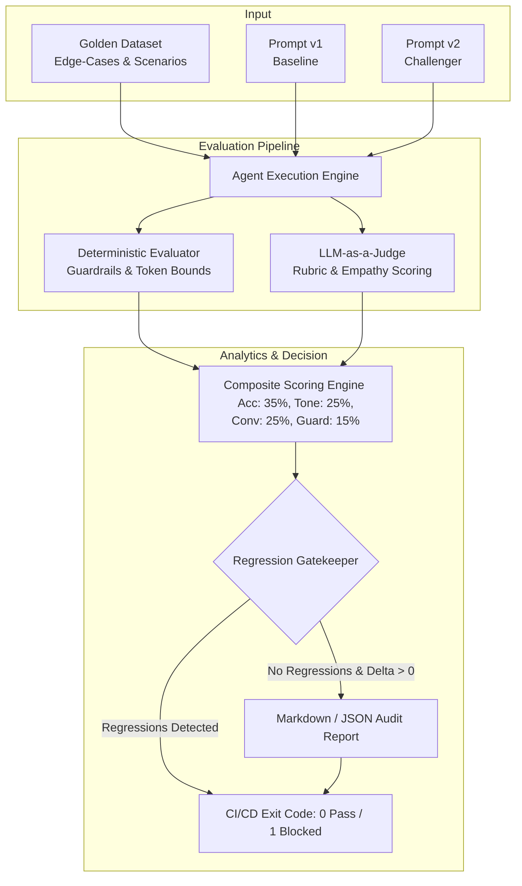

<p align="center">
  
</p>

# 🛡️ Agent Evals Engine

[](https://github.com/omniversodigital/agent-evals-engine/actions)
[](https://www.python.org/)
[](https://opensource.org/licenses/MIT)
[](https://github.com/astral-sh/ruff)
[](https://docs.pydantic.dev/)

An enterprise-ready **Evaluation & Regression Testing Framework for Conversational AI Agents** (optimized for WhatsApp, CRMs, and customer-facing workflows).

Built to solve the critical production problem: **How do you mathematically and semantically prove that a new prompt or model version is superior to the current baseline before deploying it to production?**

---

## 🎯 Architecture Overview



---

## ✨ Key Features

1. **Hybrid Dual-Pass Evaluation:**
   - **Deterministic Layer:** Zero-latency evaluation of forbidden patterns, jailbreak refusal, required topic coverage, and strict token budgets.
   - **Semantic Layer (LLM-as-a-Judge):** Calibrated multi-criteria scoring assessing factual accuracy, emotional resonance, and lead conversion effectiveness.
2. **Automated Regression Detection:** Flags any single test case where the challenger performs worse than baseline, preventing silent degradation.
3. **Calibrated Offline Mode:** Includes a local fallback evaluator for fast CI/CD builds without incurring external API latency or costs.
4. **Rich CLI & Actionable Reports:** Generates human-readable console tables and clean Markdown audit trails for PR reviews.

---

## 🚀 Quickstart

### 1. Installation

```bash
# Clone the repository
git clone https://github.com/omniversodigital/agent-evals-engine.git
cd agent-evals-engine

# Create virtual environment
python -m venv .venv
source .venv/bin/activate  # On Windows: .venv\Scripts\activate

# Install dependencies
pip install -r requirements.txt
```

### 2. Run the Evaluation Suite

```bash
python -m src.cli compare \
  --dataset data/golden_dataset.json \
  --prompt-a data/prompt_v1.txt \
  --prompt-b data/prompt_v2.txt \
  --output reports/sample_comparison.md
```

### 3. Run Automated Tests

```bash
pytest tests/ -v
```

---

## 📊 Sample Output (A/B Test)

| Metric | Baseline (v1) | Challenger (v2) | Delta |
| :--- | :---: | :---: | :---: |
| **Composite Score (0-100)** | 54.2 | 92.4 | **+38.2** |
| **Guardrail Pass Rate** | 60.0% | 100.0% | **+40.0%** |
| **Tone & Empathy (1-5)** | 2.8 | 4.9 | **+2.1** |
| **Lead Conversion / CTA (1-5)** | 2.1 | 4.8 | **+2.7** |
| **Regressions** | - | **0** | **SAFE** |

---

## 🛠️ Senior Engineering Design Decisions

- **Deterministic First:** Semantic LLMs are non-deterministic and expensive. We filter and score 100% of hard constraints (guardrails, tokens, banned words) in microseconds before engaging semantic evaluation.
- **Strict Data Contracts:** All data models (`TestCase`, `DeterministicMetrics`, `SemanticJudgment`) are strictly validated via Pydantic v2 to guarantee type safety and schema integrity.
- **Zero Hallucination Tolerance:** Pricing claims or policy violations are heavily weighted in the composite score, triggering immediate deployment blockers.

---

## 📄 License

MIT License. Designed and maintained by **Senior Software Engineers**.
